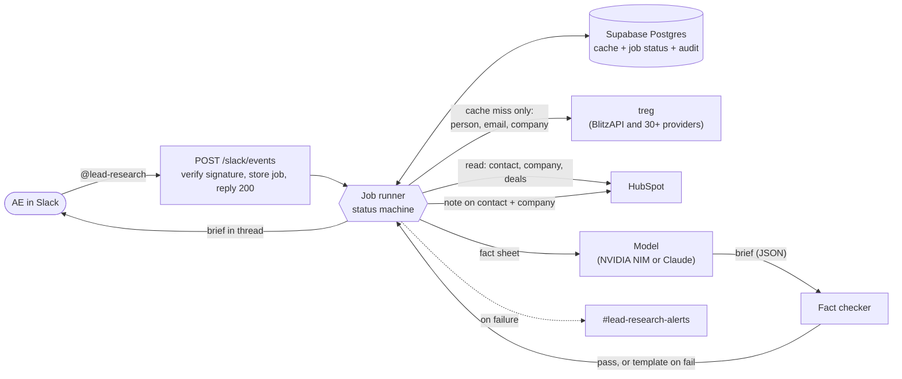
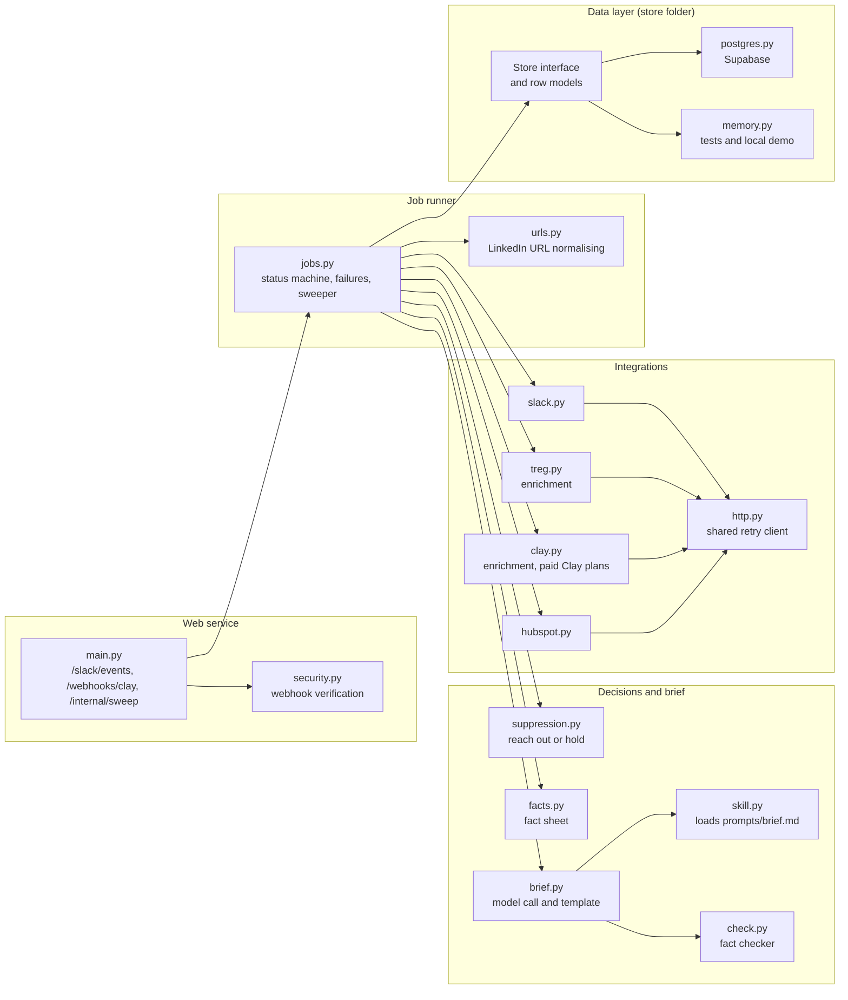

# Lead-Research Bot

AEs lose time researching people they should not contact, or researching the same person twice.
This bot fixes both: mention it in Slack with a LinkedIn URL and, about a minute later, the thread holds a
research brief that **opens with whether to reach out at all**. The same brief is saved as a note in HubSpot.

```
@lead-research https://www.linkedin.com/in/jane-doe
```

<!-- Demo GIF goes here: Slack mention -> brief in the thread -> note in HubSpot -->

It is a Python service, not a no-code workflow: every request path is code with tests, retries and logs.

## How it works



Slack calls in through a webhook. Everything else is an outbound API call from the job runner.
Postgres holds the cache and each job's status, so the service keeps no state between steps.

### Request lifecycle

Every request is one row in `research_jobs`. Each step does its work, then moves the row to the next status.

| Status | What happened | Code |
| --- | --- | --- |
| `received` | Slack signature verified, job row inserted (unique on Slack's `event_id`), 200 returned | [main.py](leadbot/main.py) |
| `normalised` | URL cleaned to `linkedin.com/in/<slug>`, "Researching..." posted. Anything else: friendly reply, `rejected` | [urls.py](leadbot/urls.py) |
| `cache_hit` / `cache_miss` | `prospects` looked up by normalised URL; fresh means enriched within 30 days | [jobs.py](leadbot/jobs.py) |
| `enriched` | Cache miss only: treg looks up the person, then their work email and company at the same time; results upserted into `prospects` and `companies` | [treg.py](leadbot/treg.py) |
| `checked` | HubSpot read; suppression verdict computed in code and stored | [hubspot.py](leadbot/hubspot.py), [suppression.py](leadbot/suppression.py) |
| `briefed` | Fact sheet → model → fact checker; template brief if anything fails | [brief.py](leadbot/brief.py), [check.py](leadbot/check.py) |
| `done` | Brief posted in the thread; contact created if new; note attached to contact and company | [jobs.py](leadbot/jobs.py) |
| `failed` | A step ran out of retries: apology in the thread, alert with `job_id` in `#lead-research-alerts` | [jobs.py](leadbot/jobs.py) |

A suppressed prospect still gets a brief. It opens with the reason ("Open deal, owner Priya, stage Proposal"),
because the AE needs that more than the research.

### Who decides what

The model writes words. Code decides everything else.

- **Suppression** is four plain functions in [suppression.py](leadbot/suppression.py): do-not-contact, open deal,
  existing customer, contacted in the last 30 days. First match wins. Adding a rule is one function and one test.
- **The model only sees a fact sheet** built by [facts.py](leadbot/facts.py) from the cache and HubSpot. The verdict
  is already in it.
- **The prompt is a file, not code.** [leadbot/prompts/brief.md](leadbot/prompts/brief.md) holds the rules, the
  output schema and three worked examples, loaded by [skill.py](leadbot/skill.py). Every answer is validated
  against that schema before it is fact-checked, and every stored brief records which prompt version wrote it.
  Tests check that each worked example passes the bot's own checker, so a broken prompt fails CI.
- **The model is a setting.** [brief.py](leadbot/brief.py) has two providers behind one interface: any
  OpenAI-compatible endpoint (NVIDIA NIM, OpenRouter) through `LLM_API_KEY` and `LLM_MODEL`, or Claude through
  `ANTHROPIC_API_KEY`. The checker and the template fallback are the same for both, so the choice of model
  changes the wording of a brief and never its facts.
- **The fact checker** rejects a brief if any number, capitalised name or date is not in the fact sheet, if the
  model changed the verdict, or if it runs over 120 words. A rejected brief is replaced by a template built from
  the same facts, and the reason is stored in `briefs.fallback_reason`.

## Numbers

Fill this in from your own runs. The audit table makes each one a query:

```sql
-- tokens per model-written brief; multiply by your model's prices for cost per lookup
-- (a free NIM model costs nothing; claude-sonnet-5-5 is $2 per million input tokens and $10 per million output)
select model, round(avg(input_tokens)) as input_tokens, round(avg(output_tokens)) as output_tokens
from briefs where source <> 'template' group by model;

-- cache hit rate, checker pass rate
select
  round(avg((suppression->>'cache' = 'hit')::int), 2)                         as cache_hit_rate,
  round(avg(check_passed::int) filter (where check_passed is not null), 2)   as checker_pass_rate
from briefs;

-- seconds per lookup, cache hit vs miss
select b.suppression->>'cache' as cache, round(avg(extract(epoch from j.updated_at - j.created_at))::numeric, 1) as seconds
from research_jobs j join briefs b on b.job_id = j.id where j.status = 'done' group by 1;
```

| Metric | Value |
| --- | --- |
| Seconds per lookup, cache hit | _to measure_ |
| Seconds per lookup, cache miss | _to measure_ |
| Cost per lookup | _to measure_ |
| Cache hit rate | _to measure_ |
| Checker pass rate | _to measure_ |

**Choosing the model.** Three free NVIDIA NIM models wrote the same briefs with reasoning on and off
([docs/model-benchmark.md](docs/model-benchmark.md)). Kimi K3.1 Pro with reasoning off passed 8 of 8 and wrote the
best briefs, in a median of 19 s. Reasoning made every model 2 to 9 times slower without raising the pass rate.
Moving the prompt into the skill file, with worked examples and schema enforcement, took Nemotron 3.5 Super VL
from 7 to 12 passes out of 12, and hold briefs that still pitched from 12 of 12 to none.

### Enrichment: treg, not Clay

The original design sent each profile to a Clay table and waited for Clay to call back. Clay's free plan does not
include the webhook source or the HTTP API column that this needs, so enrichment now goes through
[treg](https://treg.to): one API key in front of 30+ data providers, billed per answer. One person costs three
lookups (person, email, company), served by BlitzAPI for about $0.003, or nothing within BlitzAPI's free monthly
allowance. treg answers in the same request, so there is no callback to wait for. The Clay route is still in the
code and tested (`ENRICHMENT_PROVIDER=clay`, [docs/clay-setup.md](docs/clay-setup.md)) for a paid Clay plan.

What the provider returns is checked before it reaches the model: the profile's free-text "about" section is left
out (BlitzAPI's was filler text), company descriptions are cut to a sentence or two, a size band like "51-200" is
kept as text, and when someone holds several current roles the first one on the profile is used.

## Reliability

| Failure | Handling | Test |
| --- | --- | --- |
| Slack resends an event (no 200 within 3 s) | Handler only verifies, inserts and returns; work runs in the background. Unique `slack_event_id` drops the copy | `test_slack_resend_of_the_same_event_creates_one_job` |
| Forged or replayed webhook | Slack: HMAC signature and a 5-minute timestamp window. Clay: shared-secret header. Both answer 401 | `test_forged_slack_request_is_rejected`, `test_replayed_...`, `test_clay_callback_with_a_wrong_secret_is_rejected` |
| HubSpot or Slack rate limit (429), server error (5xx) | One shared client ([http.py](leadbot/http.py)): waits for `Retry-After`, else exponential backoff with jitter, 4 tries | `test_hubspot_rate_limit_is_retried_after_the_given_wait` |
| Model rate limit (429) or overload | NIM-style endpoints go through the shared client; Claude through the Anthropic SDK, which applies the same policy (4 tries, 60 s timeout). If it still fails, the template brief goes out | `test_rate_limited_model_is_retried_by_the_shared_client`, `test_a_claude_outage_falls_back_to_the_template` |
| Slow or hung API | A timeout on every call: 10 s for Slack, Clay and HubSpot, 60 s for the model, 90 s for treg (a lookup that finds nobody tries every provider, about 40 s) | `test_a_timeout_is_retried` |
| Clay never calls back (Clay route only) | The bot sweeps itself every 5 minutes and fails jobs stuck in `enriching` for over 10 minutes. (A GitHub Actions schedule was tried first: it ran every 5 to 8 hours, not every 5 minutes.) | `test_clay_that_never_calls_back_is_timed_out_by_the_sweeper` |
| Clay calls back late (Clay route only) | The data is still cached, so the next request for that person costs nothing | `test_late_clay_callback_is_still_cached` |
| The model invents a fact or changes the verdict | Checker rejects it; template brief instead; `fallback_reason` stored | `test_invented_facts_are_rejected...`, `test_the_model_cannot_change_the_verdict` |
| The model returns prose, code fences or no JSON | The JSON object is extracted if there is one; otherwise the template brief goes out | `test_json_wrapped_in_code_fences_and_prose_is_still_read`, `test_an_unusable_reply_falls_back_to_the_template` |
| treg finds nobody, or only part of the profile | Nobody: the AE is told no person was found. No email or no company record: the brief is written from what was found, and the company is looked up by the email's domain instead | `test_nobody_found_tells_the_ae`, `test_no_company_record_falls_back_to_the_email_domain`, `test_a_failing_email_lookup_does_not_stop_the_brief` |
| Process restarts mid-job | On startup, unfinished jobs resume from their last status. Status changes are compare-and-set, writes are upserts | `test_a_restarted_process_resumes_a_job_from_its_last_status` |
| Restart between Slack post and HubSpot write | `briefs.slack_ts` and `briefs.hubspot_note_id` record each half, so the finished half is not repeated | `test_a_resumed_delivery_does_not_post_the_brief_twice` |
| A step keeps failing | `failed` status, apology in the thread, alert with `job_id` and error | `test_a_step_that_keeps_failing_fails_loudly` |
| A job keeps crashing the process | Each run counts an attempt; after 5 the job fails instead of looping | `test_a_job_that_keeps_crashing_is_given_up_on` |

**Logging.** JSON, one line per event. Every line carries `job_id` and `step`; API calls add `service`,
`status_code`, `attempt` and `duration_ms`. One `job_id` traces a whole request:

```json
{"ts": "...", "level": "INFO", "logger": "leadbot.http", "msg": "api call", "job_id": "ab461d7b-...", "step": "check_crm", "service": "hubspot", "endpoint": "/crm/v3/objects/contacts/search", "attempt": 1, "status_code": 200, "duration_ms": 87}
```

**Tests.** 142 tests run in about a second with every outside API mocked at the HTTP layer (respx), so the real
clients, retries and parsers are exercised. The data-layer tests run twice: against the in-memory store, and in
CI against a real Postgres container.

**At 10x volume** the first limit is enrichment credits, then HubSpot's rate limit. The 30-day cache handles the
first: a second request for the same person makes no lookups. `MAX_CONCURRENT_JOBS` caps how many
jobs call HubSpot and the model at once, which handles the second.

## Design choices and trade-offs

- **Python, not n8n, for the request path.** Version control, tests, typed errors and retries are easier to own
  in code. A no-code tool hides the failure paths this README is mostly about.
- **Postgres as the queue.** A status column plus compare-and-set transitions is enough at this volume, and it
  means one less system to run. Past a few jobs per second, a real queue would be the next step.
- **Delivery is at-least-once.** A crash between an API call and saving its marker can repeat that one call
  (a second Slack message or HubSpot note). Exactly-once would need idempotency keys that Slack and HubSpot notes
  do not offer.
- **On Claude: structured output instead of a forced tool call.** The plan was `tool_choice` on a `write_brief` tool.
  `claude-sonnet-5-5` rejects forced tool choice, so the brief schema is passed as `output_config.format`, which
  gives the same guarantee: the reply is valid JSON for the schema.
- **On Claude: `CLAUDE_EFFORT` instead of temperature.** The same model rejects a custom temperature. Effort is the supported
  dial, and `CLAUDE_MODEL=claude-haiku-5-5` switches models for cost tests without a code change.
- **On Claude: prompt caching is marked but not active yet.** The system prompt carries `cache_control`, but Claude only
  caches prefixes of at least 512 tokens on this model and the prompt is shorter. It turns on by itself if the
  prompt grows. `briefs.cache_read_tokens` shows whether it is working.
- **On NIM-style endpoints the JSON shape is requested, not enforced.** The prompt spells out the keys and asks
  for JSON mode; if the model rejects JSON mode the call is repeated without it. The checker verifies the shape
  either way, so a model that ignores the format costs a template brief, nothing more.
- **The checker is strict on purpose.** A wrongly rejected brief costs nothing (the template goes out). A wrongly
  accepted one puts an invented fact in front of an AE. The pass rate is the number to watch; to loosen it, add
  ordinary words to `COMMON_WORDS` in [check.py](leadbot/check.py).
- **An existing HubSpot contact is never overwritten.** The CRM is the source of truth; the bot creates missing
  contacts and adds notes.
- **The raw enrichment responses are kept** (`prospects.raw`, `companies.raw`), so a new field can be backfilled without
  paying for enrichment again.

## Limits

- The numbers above still have to be measured on real traffic.
- HubSpot contacts are matched by email. With no email found, suppression uses company-level signals only and
  the note is attached to the company.
- treg reports emails as found, not verified as deliverable. The email is only used to match HubSpot contacts.
- A profile nobody can find is cached as empty for 30 days.
- Background jobs and the sweeper run inside the web process. Run one instance.
- On Render's free plan the service sleeps when idle. It depends on an outside uptime monitor to stay awake.

## Run it locally (no accounts needed)

```bash
uv sync
cp .env.example .env
uv run pytest
```

Then, in three terminals:

```bash
uv run uvicorn scripts.fake_services:app --port 8001   # stands in for Slack, Clay and HubSpot; prints what it receives
```

```bash
uv run uvicorn leadbot.main:app --port 8000
```

```bash
uv run python scripts/send_mention.py https://www.linkedin.com/in/jane-doe      # new person: enriched, then a brief
uv run python scripts/send_mention.py https://www.linkedin.com/in/jane-doe      # again: cache hit, no lookup
uv run python scripts/send_mention.py https://www.linkedin.com/in/omar-haddad   # open deal: hold, with the reason
```

With no model key every brief comes from the template. To have a model write them, set `LLM_API_KEY` and
`LLM_MODEL` in `.env` (NVIDIA NIM by default; a key is free at build.nvidia.com), or `ANTHROPIC_API_KEY` for Claude.
Without `DATABASE_URL` the store is in memory; set it to a Postgres URL and run
[migrations/001_init.sql](migrations/001_init.sql) to keep state.

## Connect the real services

1. **Supabase.** Create a project, run [migrations/001_init.sql](migrations/001_init.sql) in the SQL editor, and
   put the pooler connection string (transaction mode) in `DATABASE_URL`.
2. **Slack.** Create an app with bot scopes `app_mentions:read` and `chat:write`. Under Event Subscriptions set
   the request URL to `https://<your-host>/slack/events` and subscribe to the `app_mention` bot event. Copy the
   signing secret and bot token. Invite the bot to your sales channel and to `#lead-research-alerts`.
3. **treg.** Sign up at treg.to (new accounts get $1 of credit), create a token and put it in `TREG_TOKEN`.
   Optional: connect a BlitzAPI key under "Your own tools" (BlitzAPI's free plan covers 1,000 records a month);
   treg uses your own keys first. On a paid Clay plan, set `ENRICHMENT_PROVIDER=clay` and follow
   [docs/clay-setup.md](docs/clay-setup.md) instead.
4. **HubSpot.** Use a free account or a developer test account filled with test contacts. Create a service key
   under Development > Keys > Service keys (HubSpot stopped new private apps in October 2026; existing private
   app tokens still work). Give it these scopes: `crm.objects.contacts.read`, `crm.objects.contacts.write` (notes
   use the contact scopes), `crm.objects.companies.read`, `crm.objects.deals.read` and `crm.objects.owners.read`.
   Put the `pat-...` key in `HUBSPOT_TOKEN`. If a scope is missing, HubSpot's 403 names it and it shows up in the
   failure alert. To fill a test account with one record per suppression verdict and check that the bot decides
   each one correctly, run [scripts/seed_hubspot.py](scripts/seed_hubspot.py) (it uses a second, wider key).
5. **Deploy.** The [Dockerfile](Dockerfile) runs anywhere that runs a container. This one runs on Render's free
   plan in Frankfurt, next to the Supabase project in Ireland. Paste environment values without quotes or
   comments: unlike `.env`, Render keeps them as part of the value.
6. **Keep it awake.** A free Render service sleeps after about 15 minutes idle and took 53 s to wake, far past
   Slack's 3 seconds. Nothing breaks (Slack resends and the `event_id` check drops the copy), but the first reply
   is late, and the bot's own sweeper does not run while it sleeps. A free uptime monitor that calls `/healthz`
   every 5 minutes keeps it awake. On a paid instance this step is not needed.
7. **Manual sweep (optional).** With the secret `INTERNAL_SECRET` and the variable `BOT_URL` set in the GitHub
   repo, `gh workflow run Sweeper` triggers a sweep on demand
   ([.github/workflows/sweeper.yml](.github/workflows/sweeper.yml)).

## Layout



An arrow means "uses". Everything in the diagram lives in `leadbot/`. `config.py` (settings) and `logs.py`
(JSON logging) are used throughout and left out to keep it readable.

| Folder | Contents |
| --- | --- |
| [leadbot/](leadbot) | The service (the diagram above) |
| [migrations/](migrations) | The database schema |
| [tests/](tests) | Pipeline tests, unit tests, store contract tests |
| [scripts/](scripts) | Local stand-ins for Slack, Clay and HubSpot, and a sender for signed test events |
| [docs/](docs) | Model benchmark, Clay table setup |
